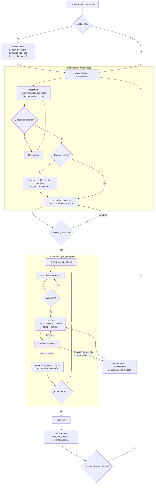

# ts-skills — SDD incremental supervisado

Desarrollo guiado por especificaciones (SDD) que combina:

- **[OpenSpec](https://github.com/Fission-AI/openspec) como memoria funcional**: reglas de negocio vigentes, historial de cambios y análisis de impacto antes de tocar nada.
- **TDD incremental como disciplina de implementación**: un test → rojo → código mínimo → verde → **parar y revisar**.

> Generar código es barato; comprenderlo, validarlo y mantenerlo sigue siendo caro. Detenerse a menudo cuesta menos que comprender de golpe miles de líneas generadas por una IA.

## Instalación

Requiere Node ≥ 20.19.

**1. Instala el CLI de OpenSpec de forma global** (una vez por máquina):

```bash
npm i -g @fission-ai/openspec
openspec config set telemetry.enabled false
```

**2. Inicializa OpenSpec e instala este flujo en el proyecto:**
(una vez por proyecto):

En Linux bash:

```bash
cd mi-proyecto
openspec init --tools roocode,opencode
curl -fsSL https://raw.githubusercontent.com/davidpoza/ts-skills/main/scripts/install.sh | bash -s -- . --tools roocode,opencode
```

En Windows PowerShell (comando "terminal"):

```powershell
cd C:\Users\<usuario>\dev\mi-proyecto
openspec init --tools roocode,opencode
& ([scriptblock]::Create((Invoke-RestMethod https://raw.githubusercontent.com/davidpoza/ts-skills/main/scripts/install.ps1).TrimStart([char]0xFEFF))) . -Tools roocode,opencode
```

El script instala `sdd-pair` como skill y, en Roo Code, OpenCode y GitHub Copilot, también como comando (`.roo/commands/`, `.opencode/commands/`, `.github/prompts/`), igual que `openspec init` hace con `/opsx:*`. En Claude Code el skill ya se invoca como `/sdd-pair`, y en Codex como `$sdd-pair`.

`/opsx:verify` no viene en el perfil por defecto de OpenSpec. Actívalo con `openspec config profile` (Change Delivery and workflows → verify) y luego `openspec update`.


## Flujo



| Paso | Comando | Qué haces tú |
|---|---|---|
| 0. Pensar (opcional) | `/opsx:explore` | Aclaras qué quieres, comparas opciones y ves qué reglas afecta |
| 1. Proponer | `/opsx:propose <descripción>` | Respondes las preguntas de `impact.md` y revisas los artefactos de proposal, design y specs |
| 2. Implementar | `/sdd-pair` (una vez por tarea) | Apruebas la lista de tests y revisas cada ciclo |
| 3. Cerrar | `/opsx:verify` → `/opsx:archive` | Confirmas que el código cumple las specs |


