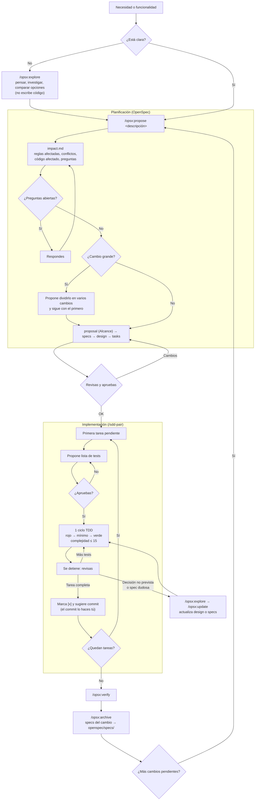

# ts-skills — SDD incremental supervisado

Desarrollo guiado por especificaciones (SDD) que combina:

- **[OpenSpec](https://github.com/Fission-AI/openspec) como memoria funcional**: reglas de negocio vigentes, historial de cambios y análisis de impacto antes de tocar nada.
- **TDD incremental como disciplina de implementación**: un test → rojo → código mínimo → verde → **parar y revisar**.

> Generar código es barato; comprenderlo, validarlo y mantenerlo sigue siendo caro. Detenerse a menudo cuesta menos que comprender de golpe miles de líneas generadas por una IA.

Dos garantías complementarias:

| | Pieza | Qué te asegura |
|---|---|---|
| **Control de producto** | OpenSpec + análisis de impacto | Sabes qué se construye, por qué y qué reglas existentes no pueden romperse |
| **Control de implementación** | `/sdd-pair` | Entiendes cada incremento antes de continuar; el agente no decide por ti |

## Flujo



| Paso | Comando | Qué haces tú |
|---|---|---|
| 0. Pensar (opcional) | `/opsx:explore` | Aclaras qué quieres, comparas opciones y ves qué reglas afecta |
| 1. Proponer | `/opsx:propose <descripción>` | Respondes las preguntas de `impact.md` y revisas specs y tareas |
| 2. Implementar | `/sdd-pair` (una vez por tarea) | Apruebas la lista de tests y revisas cada ciclo |
| 3. Cerrar | `/opsx:verify` → `/opsx:archive` | Confirmas que el código cumple las specs |

### Qué descripción recibe `/opsx:propose`

Un cambio pequeño, descrito con lo que sepas. Si viene de una historia de Jira, pégala con sus detalles:

```
/opsx:propose reasignar-recurso-manual: Como operador, quiero reasignar un recurso a otra
operación, para cubrir un cambio de última hora. Solo recursos libres en ese horario;
el supervisor no tiene que aprobarlo.
```

O directamente:

```
/opsx:propose "permitir cancelar una operación pendiente y liberar sus recursos"
```

No hace falta que la descripción sea completa. El detalle se completa al proponer: OpenSpec pregunta lo que afecte al alcance o a los criterios de aceptación, y `impact.md` añade las preguntas que te toca decidir. Si la petición es demasiado grande, la propuesta te ofrecerá dividirla en varios cambios; los demás quedan como siguientes `/opsx:propose`.

### `/opsx:explore`

Modo "pensar antes de construir" de OpenSpec: investiga el código y las specs vigentes, plantea preguntas y recomienda opciones, pero **nunca escribe código**. Úsalo en dos momentos:

- **Antes de proponer**, cuando la necesidad no está clara.
- **Cuando `/sdd-pair` se detiene** por una decisión de diseño que no está en `design.md` o una spec que parece incorrecta. Lo piensas en explore, actualizas el cambio con `/opsx:update` y vuelves a `/sdd-pair`.

Los skills de OpenSpec (propose, explore, update) tienen escrito "run `/opsx:apply`" como siguiente paso. El schema y el `context` del config les piden sugerir `/sdd-pair` en su lugar, pero es una instrucción: si alguno sigue diciendo `/opsx:apply`, usa `/sdd-pair`.

## Qué contiene

| Fichero | Qué aporta |
|---|---|
| `openspec/schemas/sdd-incremental/` | Schema OpenSpec (fork de `spec-driven`). Añade el artefacto **`impact`** antes de la propuesta (reglas afectadas, conflictos, código afectado y preguntas), convierte la propuesta en un **Alcance** funcional breve (motivo, objetivos, no objetivos y funcionalidades, sin detalles técnicos), limita el tamaño de los cambios, exige specs de reglas de negocio, tareas pequeñas ligadas a escenarios y tests de regresión, y sustituye el `apply` "haz todas las tareas" por uno incremental. |
| `openspec/config.example.yaml` | Artefactos en español (encabezados validados por OpenSpec en inglés) y `operations.apply.guidance` como red de seguridad si alguien usa `/opsx:apply`. |
| `skills/sdd-pair/` | El núcleo: pair programming sobre una tarea de `tasks.md`. Propone la lista de tests, hace un ciclo TDD y para. Nunca commitea ni cambia specs para justificar el código. Sustituye a `/opsx:apply`. |
| `scripts/install.sh`, `scripts/install.ps1` | Instalan todo en un proyecto (bash para Linux/macOS/Git Bash; PowerShell para Windows). |

No se modifica OpenSpec: se usa su CLI oficial y sus puntos de extensión documentados (schemas propios, `config.yaml`). Los skills `openspec-*` siguen siendo de OpenSpec y `openspec update` los regenera sin tocar los `sdd-*`.

## Instalación

Requiere Node ≥ 20.19.

```bash
cd mi-proyecto
npx @fission-ai/openspec@latest init --tools claude,codex,github-copilot,opencode
/ruta/a/ts-skills/scripts/install.sh . --tools claude,codex,github-copilot,opencode
npx @fission-ai/openspec@latest schema validate sdd-incremental
```

Usa en `--tools` solo los agentes que necesites, y los mismos en los dos comandos.

Los scripts de instalación también **desactivan la telemetría de OpenSpec** en la configuración global del usuario (`openspec config set telemetry.enabled false`). Para cubrir también los procesos que no lean esa configuración, define además la variable de entorno `OPENSPEC_TELEMETRY=0` (en PowerShell: `[Environment]::SetEnvironmentVariable('OPENSPEC_TELEMETRY', '0', 'User')`) y reinicia el agente y las terminales.

**En Windows** usa `install.ps1` desde PowerShell (Windows PowerShell 5.1 o PowerShell 7):

```powershell
cd C:\Users\<usuario>\dev\mi-proyecto
npx @fission-ai/openspec@latest init --tools opencode
powershell -ExecutionPolicy Bypass -File C:\Users\<usuario>\dev\ts-skills\scripts\install.ps1 . -Tools opencode
```

- `-Tools` acepta varios agentes separados por comas: `-Tools claude,opencode`.
- `-ExecutionPolicy Bypass` solo afecta a esa ejecución; hace falta porque Windows bloquea los scripts `.ps1` por defecto.
- Alternativa: `install.sh` desde Git Bash o WSL, con rutas tipo `/c/Users/<usuario>/dev/...`.

Después, añade el stack y las restricciones del proyecto en `openspec/config.yaml` (`context`).

`/opsx:verify` no viene en el perfil por defecto de OpenSpec. Actívalo con `openspec config profile` (Change workflows only → verify) y luego `openspec update`.

### Invocación por agente

| Agente | Dónde se instalan | Cómo se invocan |
|---|---|---|
| Claude Code | `.claude/skills/` | `/sdd-pair` |
| Codex | `.agents/skills/` | `$sdd-pair` |
| GitHub Copilot | `.github/skills/` | skill `sdd-pair` |
| OpenCode | `.opencode/skills/` | pide al agente que use el skill `sdd-pair`; los comandos de OpenSpec son `/opsx-propose`, `/opsx-explore`… |

En Claude Code el skill es de invocación manual (`disable-model-invocation: true`) y nunca se activa solo. Los demás agentes ignoran ese campo y pueden cargarlo por su cuenta si el contexto encaja; invócalo explícitamente.

## Principios

- **No inventar.** Lo que falta se pregunta, no se rellena.
- **Las specs son reglas de negocio, no implementación.** ✅ «Una operación cancelada libera sus recursos asignados». ❌ «`cancelOperation()` invoca `resourceRepository.deleteAll()`».
- **Reglas aprobadas ≠ cambios propuestos ≠ comportamiento implementado.** Una spec nunca cambia porque el código haga otra cosa.
- **Consultar antes de proponer.** `openspec/specs/` es lo vigente; `openspec/changes/archive/` solo explica el porqué de decisiones pasadas.
- **Pequeño y vertical.** Changes de pocos requisitos. El diseño fija la complejidad del cambio (bajo, medio o alto, según líneas estimadas y reglas de negocio implicadas) y de ella sale el tamaño de las tareas: un cambio sencillo tiene 1–2 tareas, uno complejo una por escenario. La implementación para igualmente tras cada test.
- **Complejidad cognitiva ≤ 15** (definición de SonarSource) en cada función que se escribe o se toca, siempre que sea posible. Si queda por encima, `/sdd-pair` lo avisa y propone un refactor antes de seguir; solo se acepta más de 15 con tu aprobación y un motivo.
- **Sugerir, no decidir.** Patrones, refactors y commits los decides tú.

## Limitación conocida

La parada tras cada ciclo es una **instrucción** al agente, no un bloqueo técnico: OpenSpec no la impone. El progreso sí es fiable, porque vive en las casillas de `tasks.md`. Si en la práctica el agente no se detiene de forma consistente, el siguiente paso es un hook de Claude Code que bloquee marcar una segunda tarea en el mismo turno.

Las plantillas usan encabezados en español. `openspec validate`, `list` y `archive` funcionan con ellos, pero `openspec show <cambio>` falla con "Change must have a Why section" porque busca los encabezados en inglés de la propuesta. Ningún skill de OpenSpec usa ese comando; para ver un cambio, abre sus ficheros. En las specs, los encabezados estructurales siguen en inglés porque OpenSpec los necesita para validar y archivar.

El límite de complejidad cognitiva también es una instrucción. Para que se cumpla de verdad, configúralo en el analizador del proyecto: SonarQube/SonarLint (regla de complejidad cognitiva, umbral 15), `eslint-plugin-sonarjs` (`sonarjs/cognitive-complexity: ["error", 15]`) en TypeScript/Angular, o PMD `CognitiveComplexity` en Java. `/sdd-pair` usa el analizador cuando existe y, si no, solo estima.

## Créditos

- Schema derivado de `spec-driven` de [OpenSpec](https://github.com/Fission-AI/openspec) (MIT, © OpenSpec Contributors).
- `sdd-pair` adaptado del skill `pair` de [hola-ai](https://github.com/nschurmann/hola-ai) (MIT, © Nicolas Schurmann).
