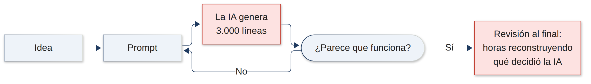
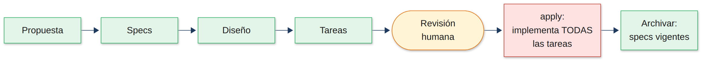
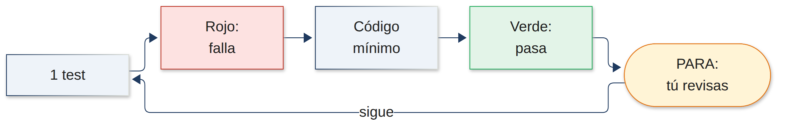
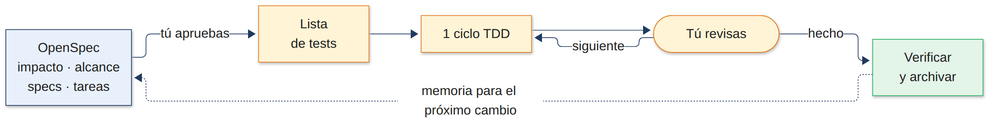
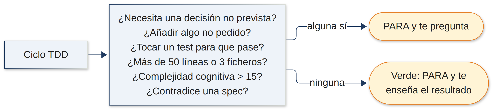
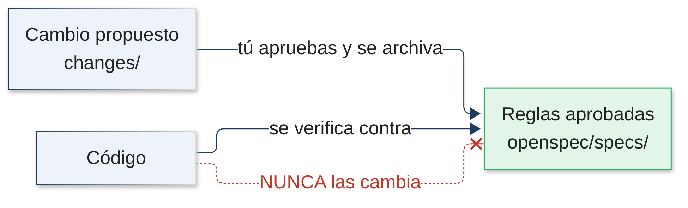

<!-- _class: portada -->
<!-- _paginate: false -->

# SDD + TDD supervisado

### Desarrollar con IA sin soltar el volante

*OpenSpec como memoria funcional · TDD incremental como disciplina de implementación*

---

<!-- _class: seccion -->

# 1. El problema: vibe coding

---

## Qué es el vibe coding

Pedirle a la IA lo que quieres y aceptar lo que genera **mientras parezca funcionar**.



- Muy rápido para prototipos.
- El problema aparece cuando ese código hay que **mantenerlo durante años**.

---

## Qué se esconde en 3.000 líneas que no has escrito

- **Requisitos supuestos** que nadie pidió.
- **Decisiones de diseño** tomadas sin preguntarte.
- **Casos de uso ignorados.**
- **Complejidad innecesaria** "por si acaso".
- **Tests que validan requisitos inventados:** si la IA inventa la regla, también escribe el test que la confirma.

> Un código puede estar bien escrito, tener todos los tests en verde y resolver **un problema distinto** del que querías resolver.

---

## Generar es barato, comprender es caro

| | Revisar 50 líneas recién hechas | Revisar 3.000 líneas al final |
|---|---|---|
| Contexto | Lo tienes fresco | Hay que reconstruirlo |
| Decisiones | Se ven una a una | Mezcladas y dependientes entre sí |
| Error de base | Se corrige al momento | Se arrastra por todo el código |
| Coste | Minutos | Horas |

> Si la IA tarda 5 minutos en generar y tú 4 horas en entenderlo, ¿cuánto has ahorrado?

Y cada sesión empieza de cero: **no queda memoria** de qué reglas se acordaron ni por qué.

---

<!-- _class: seccion -->

# 2. SDD: especificar antes de programar

---

## Spec-Driven Development (OpenSpec)

Las especificaciones se escriben **antes** del código y se guardan **junto al código**.



- `openspec/specs/` → reglas de negocio **vigentes**.
- `openspec/changes/archive/` → **historial**: por qué se decidió cada cosa.

---

## Lo que SDD resuelve bien

<div class="cols">
<div>

**Control de producto**
- Sabes qué se construye y por qué **antes** de escribir código.
- Revisas documentos cortos, no miles de líneas.

</div>
<div>

**Memoria funcional**
- Dentro de 6 meses puedes consultar qué reglas se aprobaron.
- Un cambio nuevo se analiza **contra las reglas existentes**.

</div>
</div>

> Ejemplo: *"Una operación cancelada libera sus recursos"* sigue siendo válida aunque reescribáis la arquitectura dentro de 3 años.

---

## Lo que SDD no resuelve


- `apply` implementa **todas las tareas de golpe** → volvemos a las 3.000 líneas.
- Has aprobado **qué** construir, pero no entiendes **cómo** se ha construido.
- Nada impide **ajustar las specs al código** para que cuadren.

> Documentar lo que vas a construir no sustituye comprender el código mientras se construye.

---

<!-- _class: seccion -->

# 3. Nuestro enfoque: SDD + TDD supervisado

---

## La pieza que faltaba: TDD incremental

La IA **conduce**, tú **navegas**. Un paso cada vez:



- Un test cada vez, nunca "todos los tests y luego el código".
- El test sale del **escenario aprobado**, no de la lógica del código.
- Detenerse a menudo **cuesta menos** que entender todo al final.

---

## SDD + TDD: dos controles complementarios



<div class="cols">
<div>

<span class="tag que">QUÉ construir · OpenSpec</span>
Control de producto: qué y por qué.

</div>
<div>

<span class="tag como">CÓMO construir · /sdd-pair</span>
Control de implementación: entiendes cada paso.

</div>
</div>

---

## Paso 1 · Análisis de impacto (`impact.md`)

Antes de proponer nada, la IA consulta las **reglas vigentes** y responde:

| Sección | Para qué |
|---|---|
| Requisitos afectados | Qué reglas actuales toca el cambio |
| Posibles conflictos | Dónde choca con una regla existente |
| Reglas que deben seguir cumpliéndose | Se convierten en **tests de regresión** |
| Código / componentes / API / servicios afectados | Dónde va a tocar |
| Preguntas para decidir | Lo que decides **tú**, no la IA |

> Ejemplo: "reasignación automática" choca con *"una operación finalizada no puede modificarse"*. Se detecta **antes** de escribir código.

---

## Paso 2 · Alcance, specs y tareas

<div class="cols">
<div>

**Alcance** (la propuesta)
- Motivo · Objetivos · No objetivos · Funcionalidades
- Solo funcional: **sin** ficheros, funciones ni tecnologías.
- Se lee en **menos de un minuto**.
- Si es grande, propone **dividirlo**.

</div>
<div>

**Specs y tareas**
- Specs = reglas de negocio con escenarios (criterios de aceptación).
- Tareas pequeñas: **1 ciclo TDD**, ~50 líneas, ≤ 3 ficheros.
- Cada tarea nombra su escenario y su test.

</div>
</div>

---

## Paso 3 · Implementar con `/sdd-pair`

Una tarea por ejecución. La IA **se detiene y pregunta** si:



---

## Reglas aprobadas ≠ código



- Las specs solo cambian cuando **tú** apruebas un cambio y se archiva.
- Si el código no cumple una spec, **se corrige el código** (o se propone cambiar la spec, y lo decides tú).
- `/sdd-pair` **nunca hace commit**: te sugiere el mensaje y lo haces tú.

---

## Qué problema resuelve cada pieza

| Problema | Solución |
|---|---|
| Requisitos inventados | Alcance aprobado + "pregunta, no supongas" |
| Decisiones ocultas | Paradas ante decisiones no previstas en `design.md` |
| 3.000 líneas sin revisar | 1 tarea, 1 ciclo TDD, parada en cada paso |
| Tests que validan lo inventado | Tests sacados de los escenarios aprobados |
| Romper reglas existentes | `impact.md` + tests de regresión |
| Complejidad innecesaria | Código mínimo + complejidad cognitiva ≤ 15 |
| Sin memoria entre sesiones | Specs vigentes + historial archivado |
| Specs que se adaptan al código | Las specs nunca cambian para justificar el código |

---

## El día a día

```text
[/opsx:explore]                 pensar si la necesidad no está clara
/opsx:propose <descripción>     impacto → alcance → specs → diseño → tareas
   ↳ tú revisas y apruebas
/sdd-pair                       1 tarea · 1 ciclo TDD · se detiene
   ↳ tú revisas cada ciclo y haces el commit
/opsx:verify                    ¿el código cumple las specs?
/opsx:archive                   las specs pasan a ser reglas vigentes
```

Funciona en **Claude Code, Codex, GitHub Copilot y OpenCode**.

---

## Limitaciones (con honestidad)

- **Las paradas son instrucciones**, no un bloqueo técnico.
  → Si no se cumplen de forma fiable: hook de Claude Code.
- **La complejidad ≤ 15** la estima la IA si no hay analizador.
  → Configurarla en el linter (SonarLint, `sonarjs`, PMD) la hace obligatoria.
- **Algunos encabezados de las specs siguen en inglés** (`Requirement`, `Scenario`…): OpenSpec los necesita para validar y archivar.
- **Más lento** que el vibe coding generando código… **más rápido** entendiéndolo.

---

<!-- _class: portada -->
<!-- _paginate: false -->

# La productividad no son líneas por minuto

### Es software **correcto**, **mantenible** y **comprendido** que incorporas al proyecto

*Si la IA entiende el código y tú no, has ganado velocidad pero has perdido el control.*
